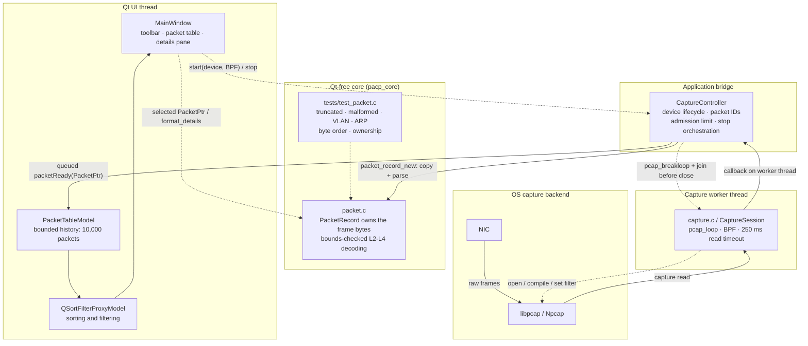

# PACP packet capture tool

[English](README.md) | [简体中文](README.zh-CN.md)

This is a small Qt 6 Widgets and libpcap/Npcap capture viewer. The previous GTK single-file implementation has been split into independently testable modules:

- src/main_window.cpp: Qt toolbar, table, splitter, details pane, and styles.
- src/capture_controller.cpp: Qt/libpcap thread bridge and bounded delivery.
- src/packet_table_model.cpp: virtual Qt table model with a fixed history size.
- src/capture.c: device discovery, BPF compilation, and a stoppable libpcap worker thread.
- src/packet.c: owned packet storage and bounds-checked Ethernet/VLAN/ARP/IPv4 TCP/UDP/ICMP decoding.
- tests/test_packet.c: parser tests for truncated frames, IPv4 options, VLAN, byte order, ARP, and ownership.

## Architecture

The runtime is split along three boundaries: Qt UI code, a thread-safe application bridge, and a Qt-free C core. The only packet handoff from the capture thread to the UI thread is the queued `packetReady(PacketPtr)` signal.

### Design principles

- **Thread isolation:** the blocking `pcap_loop` runs only on the capture worker. Packet records are parsed there and cross into the UI through a queued signal, so the UI thread never runs the capture loop or accesses packet buffers.
- **Bounded backpressure:** at most 2,000 packets may be pending delivery. Any excess is dropped and counted instead of growing memory without limit. The table separately retains at most 10,000 packets, evicting the oldest first.
- **Explicit ownership:** `packet_record_new` copies the captured bytes before the pcap callback returns. `PacketPtr` then provides shared ownership across the queued handoff, and the record is released when the table evicts it.
- **Fail-safe decoding:** every layer is length-checked. Truncated or malformed frames remain inspectable with a warning instead of causing an out-of-bounds read, and this behavior is covered by the Qt-free parser test binary.
- **Deterministic shutdown:** stop first disables packet acceptance, then calls `pcap_breakloop`, joins the worker, and only then closes the pcap handle. The 250 ms read timeout bounds how long that join can wait.
- **Testable core:** `capture.c` and `packet.c` have no Qt dependency and are built as the separate `pacp_core` library, keeping UI concerns out of the capture and decoding code.

## Build on Linux

Install Qt 6 Widgets, GLib 2, libpcap development packages, and CMake, then run:

~~~sh
make
make test
~~~

The executable is written to build/pacp. It may need root or capture capabilities to read an interface.

## Build on Windows

Use a MinGW toolchain, Qt 6 Widgets development files, GLib development files, and the Npcap SDK. The SDK must provide pcap.h, wpcap, Packet, and Winsock libraries. Configure with:

~~~sh
cmake -S . -B build -G "MinGW Makefiles" \
  -DCMAKE_BUILD_TYPE=Release \
  -DCMAKE_PREFIX_PATH="C:/Qt/6.x.x/mingw_64" \
  -DNPCAP_SDK_DIR="C:/npcap-sdk"
cmake --build build --parallel
~~~

If the Npcap SDK is installed outside the default layout, set NPCAP_INCLUDE_DIR, NPCAP_WPCAP_LIBRARY, and NPCAP_PACKET_LIBRARY explicitly. After building on Windows, run Qt's windeployqt tool on the executable to copy the required Qt platform plugin and runtime DLLs.

The capture path uses a 250 ms read timeout and pcap_breakloop; stopping the program therefore joins the worker before releasing any pcap or UI state.
