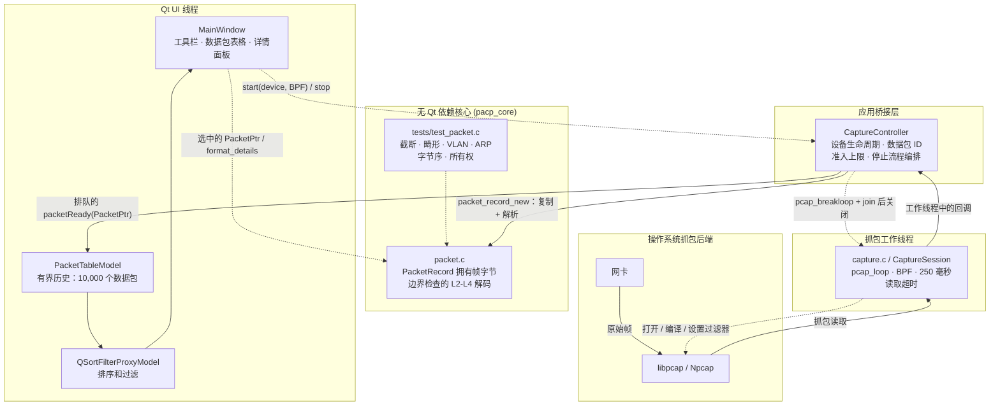

# PACP 数据包抓取工具

[English](README.md) | 简体中文

这是一个基于 Qt 6 Widgets 和 libpcap/Npcap 的小型抓包查看器。原先的单文件 GTK 实现已经拆分为多个可独立测试的模块：

- src/main_window.cpp：Qt 工具栏、数据包表格、分隔器、详情面板和样式。
- src/capture_controller.cpp：Qt 与 libpcap 之间的线程桥接，以及有界投递。
- src/packet_table_model.cpp：具有固定历史容量上限的虚拟 Qt 表格模型。
- src/capture.c：设备发现、BPF 编译，以及可停止的 libpcap 工作线程。
- src/packet.c：拥有数据包存储的所有权，并对 Ethernet/VLAN/ARP/IPv4 TCP/UDP/ICMP 进行边界检查解码。
- tests/test_packet.c：针对截断帧、IPv4 选项、VLAN、字节序、ARP 和所有权的解析器测试。

## 架构

运行时按三个边界拆分：Qt UI 代码、线程安全的应用桥接层，以及不依赖 Qt 的 C 核心。抓包线程向 UI 线程传递数据包的唯一通道是排队的 `packetReady(PacketPtr)` 信号。

### 设计原则

- **线程隔离：** 阻塞式 `pcap_loop` 只在抓包工作线程中运行。数据包记录也在该线程中解析，并通过排队信号进入 UI，因此 UI 线程从不运行抓包循环，也不访问数据包缓冲区。
- **有界背压：** 最多允许 2,000 个数据包等待投递。超出部分会被丢弃并计数，而不是无限增长内存。表格另外最多保留 10,000 个数据包，并优先淘汰最旧的记录。
- **显式所有权：** `packet_record_new` 在 pcap 回调返回之前复制抓取到的字节。随后 `PacketPtr` 在排队传递过程中提供共享所有权，当表格淘汰该记录时再将其释放。
- **故障安全解码：** 每一层都进行长度检查。截断或畸形的帧仍可带警告查看，而不会造成越界读取；这一行为由不依赖 Qt 的解析器测试程序覆盖。
- **确定性关闭：** 停止时首先禁用数据包接收，然后调用 `pcap_breakloop`，等待工作线程结束，最后才关闭 pcap 句柄。250 毫秒的读取超时限制了该等待过程的最长时间。
- **核心可测试：** `capture.c` 和 `packet.c` 不依赖 Qt，并被构建为独立的 `pacp_core` 库，从而将 UI 关注点与抓包、解码代码分离。

## Linux 构建

安装 Qt 6 Widgets、GLib 2、libpcap 开发包和 CMake，然后运行：

~~~sh
make
make test
~~~

可执行文件生成在 build/pacp。读取网络接口可能需要 root 权限或抓包能力（capture capabilities）。

## Windows 构建

使用 MinGW 工具链、Qt 6 Widgets 开发文件、GLib 开发文件和 Npcap SDK。SDK 必须提供 pcap.h、wpcap、Packet 和 Winsock 库。按以下方式配置：

~~~sh
cmake -S . -B build -G "MinGW Makefiles" \
  -DCMAKE_BUILD_TYPE=Release \
  -DCMAKE_PREFIX_PATH="C:/Qt/6.x.x/mingw_64" \
  -DNPCAP_SDK_DIR="C:/npcap-sdk"
cmake --build build --parallel
~~~

如果 Npcap SDK 未安装在默认目录结构中，请显式设置 NPCAP_INCLUDE_DIR、NPCAP_WPCAP_LIBRARY 和 NPCAP_PACKET_LIBRARY。在 Windows 上构建完成后，对可执行文件运行 Qt 的 windeployqt 工具，以复制所需的 Qt 平台插件和运行时 DLL。

抓包路径使用 250 毫秒读取超时和 pcap_breakloop；因此停止程序时会先等待工作线程结束，再释放任何 pcap 或 UI 状态。
